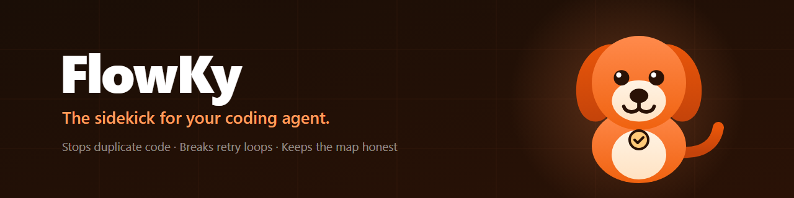

<div align="center">



<br><br>

**Your agent forgets your codebase between sessions.**

It rewrites the helper you wrote last week. It retries the command that just failed. It spends your tokens relearning a project it already knew yesterday.

We give it memory, guardrails, and a map that tells you when it has gone stale.

<br>

[](https://github.com/flowKy-ai/flowky/tree/main/docs/api)
[](https://github.com/flowKy-ai/flowky/tree/main/starter)
[](https://github.com/flowKy-ai/flowky/blob/main/TIPS.md)
[](https://github.com/flowKy-ai/flowky/discussions)

</div>

---

## See it work

Not a mockup. This is the guard catching a real duplicate, in the codebase that runs our own website:

```console
$ your agent writes safeRedirectPath()

FlowKy: this symbol already exists in this codebase.
  • safeRedirectPath — already defined in src/lib/safe-redirect.ts:14

Import and reuse the existing definition, or extend it.
```

It **asks once**, it never blocks. Overloads and re-exports are legitimate, and a hard block produces false positives that get the hook switched off within a week.

*Status: the guard runs on our own codebase. It is not in the published extension yet; it ships with the next release.*

---

## Why a hook and not a prompt

This is the whole product in one distinction, and it is worth stating plainly because most tooling in this space gets it wrong.

|  | Instructions in a context file | A lifecycle hook |
|---|---|---|
| When it applies | While the model happens to remember | Every single time, without exception |
| Survives a long session | Degrades as the window fills | Unaffected |
| Survives compaction | Only if unscoped and at the root | Unaffected |
| Enforcement | Advisory | Actual |

Anything that **must** hold belongs in a hook. Anything contextual belongs in a rule or a skill. Writing "never recreate an existing function" in a config file and expecting compliance is the mistake this product exists to fix.

---

## What we install

```
your-project/
├── CLAUDE.md                     # gotchas only, hard-capped under 200 lines
├── .claude/
│   ├── rules/
│   │   ├── conventions.md        # unscoped: survives compaction
│   │   └── api.md                # paths-scoped: loads on matching files only
│   ├── skills/project-map/       # tree, symbols, imports — opened on demand
│   └── settings.json             # hook wiring
└── .flowky/
    ├── index/symbols.tsv         # what the write guard queries
    └── hooks/flowky-guard.mjs    # Node, so macOS, Linux and Windows alike
```

Today the published extension writes `CLAUDE.md`, the rules and the project-map skill. The hook wiring in `settings.json` and the guard file arrive with the next release.

Three decisions in that layout, each one deliberate:

**The directory tree is not in `CLAUDE.md`.** Claude Code's own `/doctor` strips directory layouts from context files, because the model can derive them and a written-down tree goes stale on the next refactor. It lives in a skill, where it costs nothing until something opens it.

**Absolute rules are unscoped.** Path-scoped rules are dropped on compaction and only return when a matching file is read. A "never commit secrets" rule in a scoped file stops applying halfway through a session — silently.

**The hooks are Node, not shell.** A `.sh` is dead on Windows without Git Bash; a `.ps1` is dead everywhere else. One runtime, three platforms, no second-class citizen.

---

## Works with what you already use

Built for Claude Code. The project map and the generated configuration also work with Cursor, Copilot and other agents that read files in your repository.

We do not replace them. We sit underneath and stop them repeating themselves.

**In the published VS Code extension today**

|  |  |
|---|---|
| **Gives your agent a map** | Directory tree, symbols and import graph in a skill it opens on demand. Sessions that never open the map pay zero tokens for it. |
| **Writes the configuration** | One command writes `CLAUDE.md`, path-scoped rules and the project-map skill from your real codebase. |
| **Your keys, your machine** | OpenAI, Anthropic, Google, or anything OpenAI-compatible. Model calls go straight to your provider, not through us. |

**Coming with the next release**

|  |  |
|---|---|
| **Stops duplicate code** | Every function and class indexed. The agent gets the file and line before the write lands. |
| **Breaks the retry loop** | Third identical failure, interrupted, shown the error it kept skipping past. |
| **Keeps the map honest** | Records the commit it was built from and reports the drift. A stale map that reads as confident is worse than no map. |

---

## Open source

Everything in **[`flowky`](https://github.com/flowKy-ai/flowky)** is MIT.

| | |
|---|---|
| **[API reference](https://github.com/flowKy-ai/flowky/tree/main/docs/api)** | Endpoints, auth, rate limits — and the client mistakes worth avoiding, including the one that silently downgrades a paying user to the free tier |
| **[Website starter](https://github.com/flowKy-ai/flowky/tree/main/starter)** | Zero dependencies, one readable file. Scaffolds a site that ships with agent config already in place, because config written on day one is short and true, and config written on day ninety is archaeology |
| **[Tips](https://github.com/flowKy-ai/flowky/blob/main/TIPS.md)** | Short and checkable. "Put your build command in CLAUDE.md" beats "maintain good documentation" |
| **[FlowKy Bot](https://github.com/flowKy-ai/flowky/blob/main/.github/scripts/flowky-bot.mjs)** | Our dependency bot. It applies the updates, runs your build, and when something breaks it binary-searches for the culprit, drops it, and ships the rest. What lands is green by construction — see below |

The extension and web application are closed source.

### FlowKy Bot

A dependency pull request that says "tests failing" has moved the work to you, not away from you. So ours does not open one until it knows what passes.

```console
2 outdated, 2 candidates, 1 with advisories.
  verification failed on `test` with 2 updates — isolating
  held back `ms` — breaks `test`

→ Updated and verified:  semver 7.5.0 → 7.8.5  (fixes a high advisory)
→ Held back:             ms     2.0.0 → 2.1.3  (breaks `test`)
```

Isolation is a binary search, so k culprits cost O(k log n) runs rather than testing every update on its own. Majors are held back, except when one carries a live advisory — an unpatched vulnerability is worse than a breaking change you were warned about. Zero dependencies, because a tool that audits your supply chain should not enlarge it. It is a reusable workflow: `uses: flowKy-ai/flowky/.github/workflows/flowky-bot.yml@main`.

---

## How this organisation is run

Stated because it is checkable, and because a policy nobody can verify is decoration.

- **Every repository requires a review, resolved conversations and linear history** on its default branch, private ones included. No force-pushes, no branch deletion. Owners can bypass — with one member, requiring an approval nobody is allowed to give would deadlock the repository outright — and every bypass lands in the audit log. That is a real limit of a small org, and worth saying rather than implying a gate that is not there.
- **`GITHUB_TOKEN` is read-only by default** in every repository, and workflows cannot approve their own pull requests. The historical default was write-all, which is the mechanism behind most Actions supply-chain incidents.
- **Secret scanning with push protection** on public repositories — it blocks a credential before it enters history, where removing it means a rewrite and a rotation.
- **Advisory alerts on, automated dependency pull requests off.** [FlowKy Bot](https://github.com/flowKy-ai/flowky/blob/main/.github/scripts/flowky-bot.mjs) opens those instead, and it opens them already tested. Two bots filing for the same advisory is how a security queue starts getting ignored.
- **Superseded repositories are archived, not deleted.** They are read-only, so nobody mistakes one for live, and the history stays recoverable.
- **No contact address is published that we have not verified.** A security policy routing reports into a void is worse than one that only offers the form that works.

---

## Security

Report privately: **Security → Report a vulnerability** on any repository here. Never open a public issue for a vulnerability.

First response within 3 working days. We credit reporters unless they prefer otherwise, and good-faith research under [our policy](https://github.com/flowKy-ai/.github/blob/main/.github/SECURITY.md) will not be pursued.

FlowKy is bring-your-own-key: provider credentials stay in the user's editor. If any part of the product appears to send a key anywhere, treat that as a vulnerability.

---

<div align="center">

[X](https://x.com/flowky_ai) · [LinkedIn](https://www.linkedin.com/company/flowky-ai/) · [Instagram](https://www.instagram.com/flowky.ai/) · [TikTok](https://www.tiktok.com/@flowky.ai)

<sub>Paris, France · <a href="https://github.com/flowKy-ai/.github/blob/main/.github/CODE_OF_CONDUCT.md">Code of conduct</a> · <a href="https://github.com/flowKy-ai/flowky/blob/main/CONTRIBUTING.md">Contributing</a></sub>

</div>

---

<sub>FlowKy is an independent product. It is not affiliated with, endorsed or sponsored by Anthropic, or by the makers of the other tools named here. Claude and Claude Code are trademarks of Anthropic, PBC; all other names are trademarks of their respective owners.</sub>
